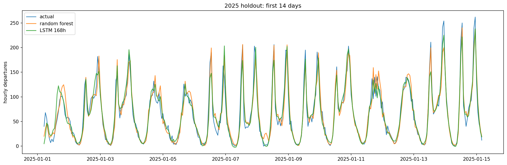

# JC Citi Bike 下一小时出发量预测

面向求职作品集的完整时间序列数据科学项目：将 Citi Bike JC 月度行程、历史天气与当地日历对齐，比较传统机器学习和 PyTorch 模型，预测下一小时的行程出发次数。



**当前状态：**数据审计、EDA、特征工程、基线、MLP/LSTM、开发折评估与 2025 留出期确认均已完成。重要限制：早期探索脚本曾查看过一次 2025 指标；这些结果没有用于调参，但该留出期不属于完全未触碰的盲测。

## 结果摘要

2025 年共同评分样本为 8,590 小时；同一模型配置下 MAE 越低越好，RMSE/R² 从不同角度衡量误差。

| 模型 | MAE | RMSE | R² |
| --- | ---: | ---: | ---: |
| Random Forest | **14.96** | 23.60 | 0.943 |
| Random Forest + historical weather | 15.11 | 23.83 | 0.942 |
| LSTM (168 h) | 15.13 | **22.56** | **0.948** |
| MLP | 16.01 | 24.48 | 0.939 |
| Linear Regression | 21.85 | 32.45 | 0.892 |
| Previous-week same hour | 29.72 | 48.75 | 0.756 |
| Previous-hour naive | 35.12 | 52.07 | 0.722 |

随机森林 MAE 最低；LSTM 的 RMSE 和 R² 较好，但没有全面胜过随机森林。加入天气的随机森林没有超过无天气版本。没有根据 2025 指标继续调参。完整结果、开发折比较、消融与误差切片见 [统一评估报告](results/JC_EVALUATION.md)。

## 数据与任务

- **范围：**Citi Bike 官方 `JC-` 月文件的发布服务范围，不等同于 NYC 全城，也不是严格的 Jersey City 行政边界筛选。
- **目标：**按出发时间计数的每小时行程数。它表示被记录的使用量，不等同于不受车辆供给限制的潜在需求。
- **时间：**2024 年开发与滚动验证；2025 年最终留出期。以 UTC 排序/评分，当地日历特征使用 America/New_York。
- **天气：**Open-Meteo Historical Weather API 的网格历史天气。预测下一小时只使用此前小时的天气历史；天气数据的产品类型、发布可用性、空间代表性限制见报告。目标小时天气只用于事后误差切片。
- **DST 与重复：**源时间戳是无偏移的本地时间；无法消歧的秋季重复小时出发记录排除，相应目标小时不评分。重复 ride_id 去重与冲突排除策略见 [全量审计](results/JC_FULL_AUDIT.md)。

数据来源、引用、许可和缓存说明见 [data/README.md](data/README.md)。原始行程与天气缓存不会提交到仓库。

## 环境与运行

使用 Python 3.9+。CPU 可运行全流程；PyTorch GPU 安装需按操作系统、CUDA/驱动从 PyTorch 官方安装说明选择对应构建。

```bash
pip install -r requirements.txt
python -m src.jc_download
python -m src.jc_year_audit
python -m src.jc_prepare
jupyter notebook
```

首次运行需要网络下载官方行程和天气；之后可复用忽略目录中的缓存。Notebook 按以下顺序查看：

1. `02_jc_eda.ipynb`：训练/开发期探索与天气对齐检查。
2. `03_jc_baselines.ipynb`：朴素基准、线性回归、随机森林和天气消融。
3. `04_jc_pytorch.ipynb`：PyTorch MLP 与 168 小时 LSTM。
4. `05_jc_evaluation.ipynb`：共同样本模型比较、特征消融、误差切片。
5. `06_jc_final_confirmation.ipynb`：只读取已保存的 2025 留出期结果，不重新训练。

`00_uci_prototype.ipynb` 是原始 UCI 方案的历史原型，不属于当前 JC 主线。

命令行入口：

- `python -m src.jc_download`：下载并校验 2024—2025 全部 24 个官方 JC 月文件。
- `python -m src.jc_year_audit`：审计跨文件重复、时间戳与 DST。
- `python -m src.jc_prepare`：准备连续 UTC 小时目标及审计报告。
- `python -m src.jc_baseline_models`：运行经典模型的开发折验证。
- `python -m src.jc_torch_models`：运行 PyTorch 开发折验证。
- `python -m src.jc_stage4`：统一开发期比较、消融和误差分析。
- `python -m src.jc_final_eval`：仅在 2025 确认产物尚不存在时运行一次。该命令检测到已有最终结果时会拒绝覆盖。

运行测试：`python -m unittest discover -s tests -v`。

## 项目结构

```text
configs/          时间切分、数据和实验约定
data/README.md    数据来源与使用限制
notebooks/        EDA、基线、深度模型、评估和留出期结果
src/              下载、审计、特征、模型与评估实现
tests/            时间对齐、防泄漏、DST、评估对齐测试
results/          汇总审计、指标、误差分析和图表
```

逐小时预测明细、试验小时 CSV、原始归档、天气缓存、模型权重、虚拟环境和本机 VS Code 设置均不会提交。仓库仅保留许可允许范围内的分析汇总与图表。

## 复现边界与后续

- 时间序列使用扩展窗口验证，不随机打乱；滚动一步预测只使用预测时刻之前已发生的观测。
- 历史天气产品不等同于当时已发布的天气预报，当前实验是离线回测假设，不可直接宣称已验证实时部署性能。
- 2025 留出期结果必须与“曾被早期探索查看”的事实一起呈现。
- GitHub 仓库尚未发布；本地文件通过安全检查后再推送。
- 项目代码尚未声明开源许可；上游行程与天气数据继续分别遵守各自条款，不随项目代码许可改变。
- GitHub 尚未初始化远程仓库；发布前需确认仓库账号与项目代码许可。
